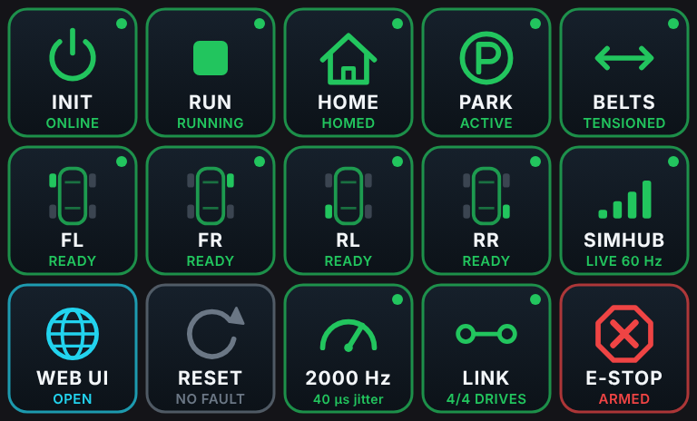

# nullCAT for Stream Deck

Live status tiles and control buttons for [nullCAT](https://github.com/crossthenoughts/nullCAT), the open-source EtherCAT motion controller for sim rigs. The plugin polls nullCAT's `/api/status` once a second and redraws each key (colour + text) to match the rig. Unofficial, not affiliated with nullCAT.

## Keys

| Key | Press | Shows |
|---|---|---|
| Init | `POST /api/init-toggle` | offline / working / online |
| Run | `POST /api/run-toggle` | stopped / running / needs init |
| Home | `POST /api/home` | needs home / homing / homed |
| Park | `POST /api/park-toggle` | unparked / active / parked |
| Belts | `POST /api/belts-toggle` | none / slack / tensioned |
| Drive FL/FR/RL/RR | – | per-drive state, fault |
| SimHub | – | UDP telemetry live / no data |
| Web UI | opens the nullCAT UI | – |
| Reset fault | `POST /api/reset-fault` | fault indicator |
| Loop stats | `POST /api/resetstats` | loop Hz + jitter |
| Link | refresh | controller reachable, slaves found |
| E-STOP | `POST /api/estop` | armed / active |

> **Safety:** the E-STOP key is nullCAT's *software* e-stop. It is not a safety device. A hardware e-stop wired to the drives is required (see nullCAT's SAFETY.md). Releasing an e-stop is only possible from the nullCAT desktop app by design.

## Install

1. Edit the base URL in `src/plugin.js` if your controller is not at `http://nullcat.local:8080`.
2. `npm install && npm run build` (needs Node 20+ and Python 3 with `playwright` + Chromium for icon rendering).
3. Double-click `nullCAT.streamDeckPlugin`.
4. Create the profile: `python3 make_profile.py --layout mk2|plus|xl --device-uuid "<your device UUID>"`, copy the generated `profile/*.sdProfile` folder into `%APPDATA%\Elgato\StreamDeck\ProfilesV3` while Stream Deck is **closed**, then start Stream Deck. (Device UUID: see any existing MK.2 profile's `manifest.json`.) Or drag the actions from the **nullCAT** category onto any profile yourself.

Requires Stream Deck 6.4+ on Windows. Profile layouts: `mk2` (15 keys), `plus` (8 keys + 4 dials showing the drive states) and `xl` (32 keys). The XL layout is untested.

## How it works

`src/icons.js` draws every key as SVG from the status JSON; `src/plugin.js` talks to the Stream Deck SDK over WebSocket and sets those SVGs live. `render.py` also renders static PNG fallbacks. nullCAT only accepts requests whose Host header is its own address, so use the hostname/IP the controller answers to.

## License

MIT
